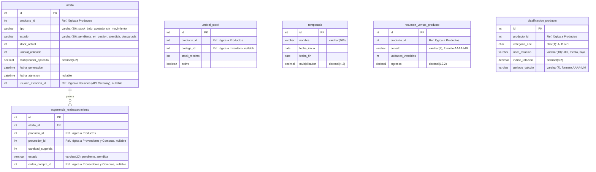

# Diagrama entidad-relación – Alertas y Analítica

Base de datos: `analitica` (propia del microservicio).

El modelo tiene seis tablas. La única llave foránea es interna: `sugerencia_reabastecimiento.alerta_id` hacia `alerta.id`.
Los campos `producto_id`, `bodega_id`, `proveedor_id`, `usuario_atencion_id` y `orden_compra_id` son **referencias lógicas** a otros servicios: guardan solo el identificador, sin llave foránea, para cumplir el requerimiento de bases de datos independientes (RNF02).

## Tablas

| Tabla | Propósito |
|---|---|
| `umbral_stock` | Nivel mínimo configurable por producto o bodega. |
| `temporada` | Temporadas con su multiplicador de demanda. |
| `alerta` | Alertas generadas por el sistema y su estado de atención. |
| `sugerencia_reabastecimiento` | Recomendación de compra derivada de una alerta. |
| `resumen_ventas_producto` | Copia resumida del historial de ventas por producto y período. |
| `clasificacion_producto` | Resultado del análisis de rotación y clasificación A, B o C. |

## Relaciones

| Origen | Destino | Cardinalidad | Tipo |
|---|---|---|---|
| `sugerencia_reabastecimiento.alerta_id` | `alerta.id` | N:1 | Llave foránea interna |

## Referencias lógicas (sin llave foránea)

| Campo | Servicio dueño del dato |
|---|---|
| `producto_id` | Productos |
| `bodega_id` | Inventario |
| `proveedor_id` | Proveedores y Compras |
| `orden_compra_id` | Proveedores y Compras |
| `usuario_atencion_id` | API Gateway y Usuarios |