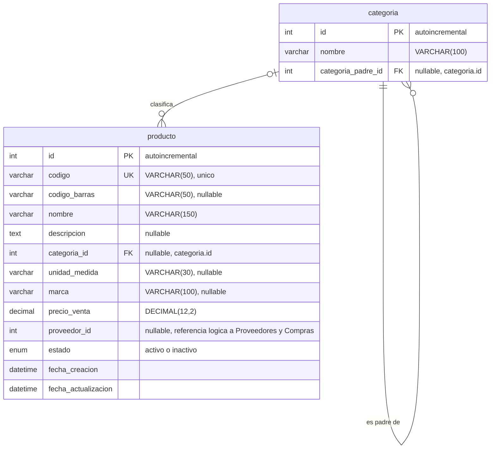

# Modelo entidad-relación: Productos

Base de datos propia: `productos` (MySQL). Este servicio no tiene llaves foráneas hacia otras bases de datos.

## Integridad referencial

| Relación | Tipo | Observación |
|---|---|---|
| `categoria.categoria_padre_id` → `categoria.id` | FK real (misma base de datos) | Jerarquía de máximo dos niveles, validada en la aplicación. |
| `producto.categoria_id` → `categoria.id` | FK real (misma base de datos) | `ON DELETE RESTRICT`: no se elimina una categoría con productos. |
| `producto.proveedor_id` | Referencia lógica | Apunta a `proveedores.id` de Proveedores y Compras. No es FK física porque pertenece a otra base de datos. |

## Restricciones e índices

- `producto.codigo`: `UNIQUE`.
- `categoria (nombre, categoria_padre_id)`: `UNIQUE`. En MySQL los valores `NULL` no se consideran iguales, así que para las categorías raíz la unicidad del nombre también se valida en la aplicación.
- `producto.categoria_id`, `producto.proveedor_id` y `producto.estado`: índices para los filtros del listado y de la búsqueda.

## Cambios respecto a la Entrega 2

No hay cambios en las tablas ni en los campos. Se agregan las restricciones `UNIQUE (nombre, categoria_padre_id)` y los índices de arriba, que el diccionario de datos no mencionaba.
