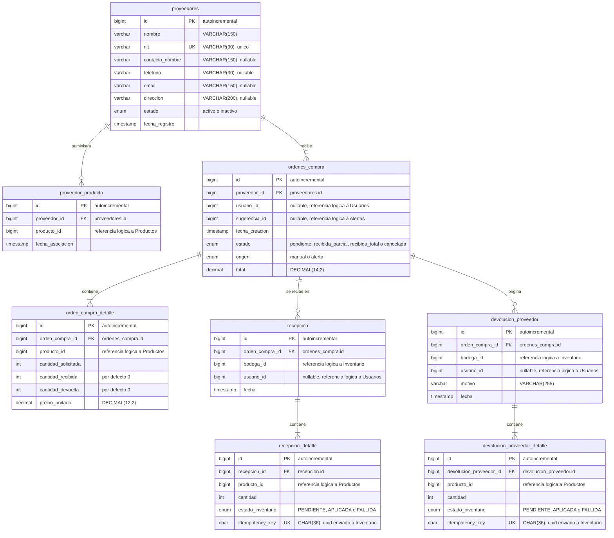

# Modelo entidad-relación: Proveedores y Compras

Base de datos propia: `compras` (MySQL). Las referencias a otros servicios son lógicas: guardan solo el identificador, sin llave foránea.

## Integridad referencial

| Campo | Tipo | Observación |
|---|---|---|
| `proveedor_producto.proveedor_id`, `ordenes_compra.proveedor_id` | FK real | Hacia `proveedores.id`, misma base de datos. |
| `orden_compra_detalle.orden_compra_id`, `recepcion.orden_compra_id`, `devolucion_proveedor.orden_compra_id` | FK real | Hacia `ordenes_compra.id`, misma base de datos. |
| `recepcion_detalle.recepcion_id`, `devolucion_proveedor_detalle.devolucion_proveedor_id` | FK real | Hacia su encabezado, misma base de datos. |
| `producto_id` (en todas las tablas que lo tienen) | Referencia lógica | Apunta a Productos. Se valida por API, sin FK física. |
| `usuario_id` | Referencia lógica | Apunta a Usuarios, en el API Gateway. |
| `bodega_id` | Referencia lógica | Apunta a las bodegas de Inventario. |
| `sugerencia_id` | Referencia lógica | Apunta a las sugerencias de Alertas y Analítica. |

## Restricciones e índices

- `proveedores.nit`: `UNIQUE`.
- `proveedor_producto (proveedor_id, producto_id)`: `UNIQUE`.
- `orden_compra_detalle (orden_compra_id, producto_id)`: `UNIQUE`, para no repetir un producto en la misma orden.
- `recepcion_detalle.idempotency_key` y `devolucion_proveedor_detalle.idempotency_key`: `UNIQUE`.
- `ordenes_compra (estado)` y `ordenes_compra (proveedor_id)`: índices para los filtros del listado.
- El proveedor de una devolución no se guarda: se obtiene a través de `ordenes_compra.proveedor_id`.

## Cambios respecto a la Entrega 2

| Cambio | Motivo |
|---|---|
| Tablas nuevas `recepcion` y `recepcion_detalle` | Guardar cada recepción con su bodega y la `idempotency_key` de cada línea enviada a Inventario, para reintentar sin duplicar stock. |
| Tablas nuevas `devolucion_proveedor` y `devolucion_proveedor_detalle` | La Entrega 2 asigna las devoluciones a proveedores a este servicio (RF13), pero no tenían modelo de datos. |
| Columna nueva `orden_compra_detalle.cantidad_devuelta` | Limitar las devoluciones a lo recibido. |
| Columna nueva `ordenes_compra.sugerencia_id` | Trazabilidad de las órdenes creadas a partir de una alerta. |
| `UNIQUE` en `proveedor_producto` y en `orden_compra_detalle` | Evitar asociaciones y líneas duplicadas. |
